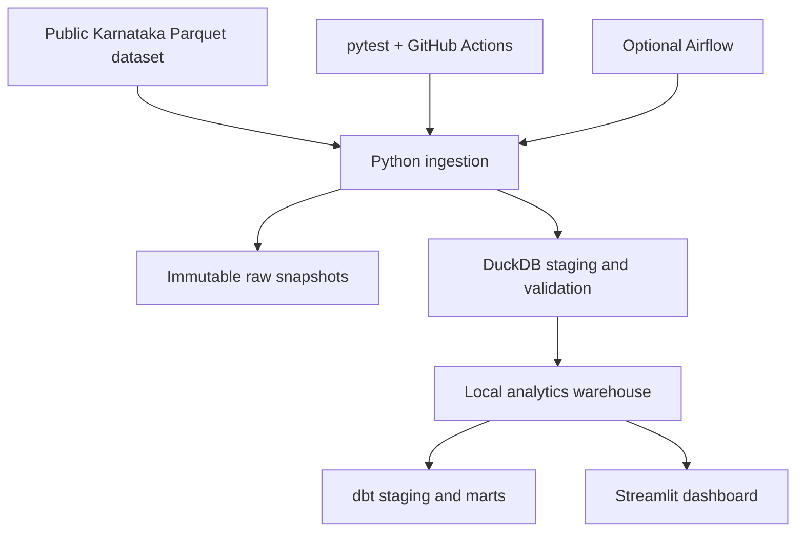

# Karnataka Data Intelligence Platform (No Docker)

An end-to-end, local-first data engineering portfolio project using a public Karnataka taluk-boundary Parquet dataset. It demonstrates source ingestion, immutable raw snapshots, DuckDB processing, incremental/idempotent loading, dbt transformations, data-quality checks, an optional Airflow DAG, Streamlit dashboard, pytest, and GitHub Actions.

## Data source

Default source URL is configured in `config/settings.py` and can be overridden with `DATA_SOURCE_URL`:

`https://data.source.coop/krishnaglodha/ksrsac-gis/main/Taluk.parquet`

The Source Cooperative collection describes its contents as boundary datasets published by Karnataka GIS / KSRSAC:
- Collection: https://source.coop/krishnaglodha/ksrsac-gis
- Official K-GIS downloads portal: https://kgis.ksrsac.in/kgis/downloads.aspx

Check the current source terms/licence and attribution before redistribution. This project downloads the data at runtime; it does not bundle source data. Never commit downloaded data, private landowner information, employer workbooks, internal endpoints, or company tools.

## Architecture



## 1. Install prerequisites

- Python 3.11
- Git
- VS Code (recommended)
- PostgreSQL is optional. The default project runs with a local DuckDB warehouse and requires no database server.
- Docker is not required.

## 2. Setup on Windows PowerShell

```powershell
py -3.11 -m venv .venv
.venv\Scripts\Activate.ps1
python -m pip install --upgrade pip
pip install -r requirements.txt
Copy-Item .env.example .env
```

If PowerShell blocks activation:
```powershell
Set-ExecutionPolicy -Scope Process -ExecutionPolicy Bypass
.venv\Scripts\Activate.ps1
```

## 3. Run the pipeline

```powershell
python -m src.pipeline
```

The pipeline:
1. Downloads the public Parquet source.
2. Saves an immutable raw snapshot under `data/raw/`.
3. Reads and profiles the Parquet with DuckDB.
4. Computes stable row hashes.
5. Upserts current records into `data/warehouse.duckdb`.
6. Records run metadata and snapshot history.
7. Quarantines rows that cannot be serialized safely.

Run it again to test idempotency. Repeated identical snapshots should not multiply current feature rows.

## 4. Launch the dashboard

```powershell
streamlit run dashboard/app.py
```

## 5. Run tests

```powershell
pytest -q
```

## 6. dbt transformations

Install dbt separately into the same virtual environment:
```powershell
pip install dbt-duckdb
```

From the repository root:
```powershell
dbt debug --project-dir transformations --profiles-dir transformations
dbt run --project-dir transformations --profiles-dir transformations
dbt test --project-dir transformations --profiles-dir transformations
```

The dbt profile uses the local DuckDB file at `data/warehouse.duckdb`.

## 7. Optional Airflow orchestration

Airflow is intentionally optional because it is resource-heavy and its dependencies can conflict with other Python packages. For a real Airflow environment, use a separate Python 3.11 virtual environment and follow the official constraints-based installation guide:
https://airflow.apache.org/docs/apache-airflow/stable/installation/installing-from-pypi.html

Copy `dags/karnataka_pipeline.py` into your Airflow DAG folder and configure its Python environment to include this project's dependencies. The DAG invokes `src.pipeline.run_pipeline`.

## 8. GitHub

```powershell
git init
git add .
git commit -m "Build Karnataka data engineering platform"
git branch -M main
git remote add origin https://github.com/YOUR_USERNAME/karnataka-data-intelligence.git
git push -u origin main
```

Create the GitHub repository first. `.env`, `.venv`, `data/`, and local database files are ignored.

## Implemented scope and honest limitations

Implemented:
- Runtime source download and raw snapshot archival
- DuckDB local warehouse
- Snapshot hash tracking
- Deterministic feature hashing and idempotent upserts
- Basic source-agnostic validation and quarantine
- dbt staging/mart starter models and tests
- Streamlit dashboard
- pytest tests and GitHub Actions

Not claimed as complete:
- Source edit-date watermarking: this source is a file snapshot, so the pipeline uses content-hash snapshot tracking instead.
- Domain-specific parcel fact table and district/taluk/village SCD Type 2: the selected source is a taluk-boundary dataset; do not invent parcel-level grain or historical admin changes.
- Geometry validity checks: implement after inspecting the actual geometry column and CRS.
- Airflow deployment: DAG code is included, but Airflow is optional and not installed by the default requirements.

## Resume integrity

Only describe features that you have run and verified. This is a local portfolio project, not a production deployment.
